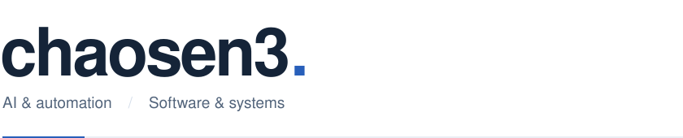
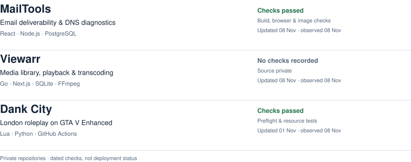
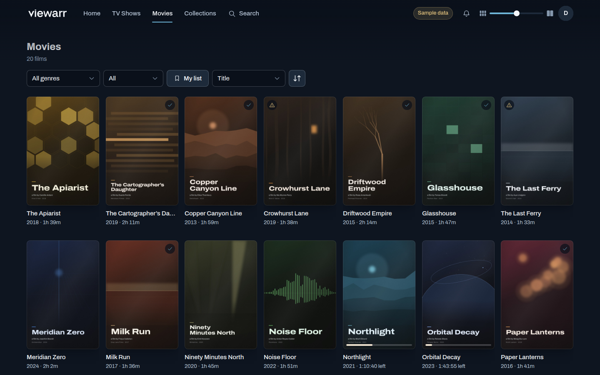
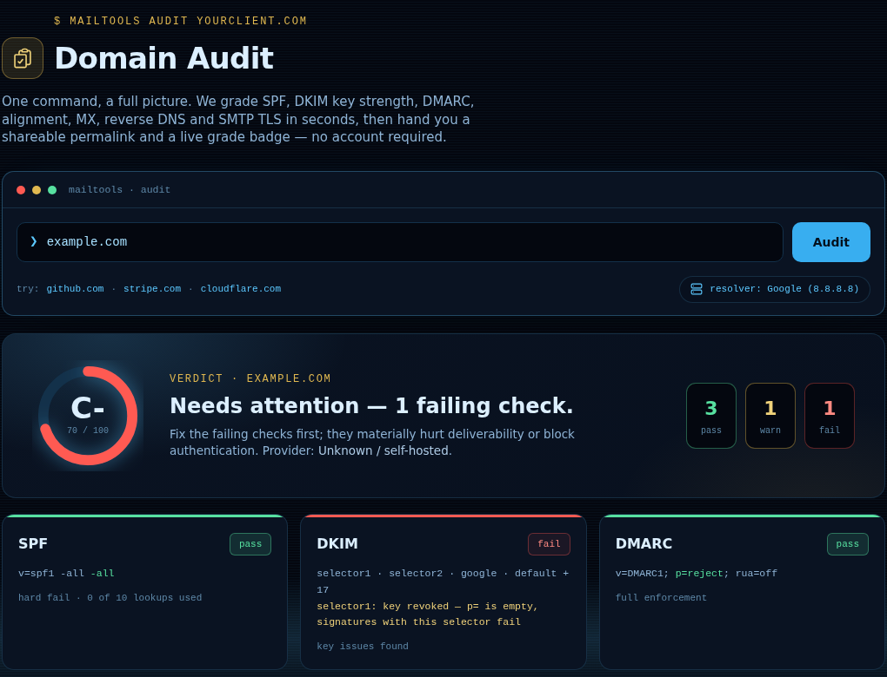
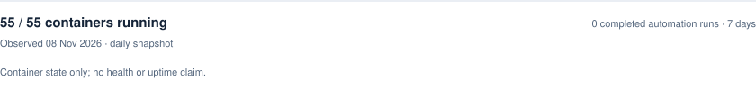

<picture>
  <source media="(prefers-color-scheme: dark) and (max-width: 600px)" srcset="https://raw.githubusercontent.com/chaosen3/chaosen3/main/assets/profile-dark-mobile.svg">
  <source media="(prefers-color-scheme: dark)" srcset="https://raw.githubusercontent.com/chaosen3/chaosen3/main/assets/profile-dark.svg">
  <source media="(max-width: 600px)" srcset="https://raw.githubusercontent.com/chaosen3/chaosen3/main/assets/profile-light-mobile.svg">
  
</picture>

AI and automation engineer with a background in Microsoft 365, infrastructure and PowerShell. Building tools for email diagnostics, media and game servers.

 

## Selected work

<!-- projects:start -->
<picture>
  <source media="(prefers-color-scheme: dark) and (max-width: 600px)" srcset="https://raw.githubusercontent.com/chaosen3/chaosen3/main/assets/projects-dark-mobile.svg?v=3-b78eee753cec">
  <source media="(prefers-color-scheme: dark)" srcset="https://raw.githubusercontent.com/chaosen3/chaosen3/main/assets/projects-dark.svg?v=3-b78eee753cec">
  <source media="(max-width: 600px)" srcset="https://raw.githubusercontent.com/chaosen3/chaosen3/main/assets/projects-light-mobile.svg?v=3-b78eee753cec">
  
</picture>
<!-- projects:end -->

Project notes

**[MailTools](https://mailtools.hashemlabs.com)** covers email deliverability and DNS diagnostics, report ingestion, monitoring and alerting. Its reasoning engine explains deterministic checks, with a 31-case evaluation harness for those explanations.

**Viewarr** owns library scanning, metadata, playback, transcoding, subtitles and watch history. It preserves the catalogue when media storage becomes unavailable.

**Dank City** is a London-themed FiveM roleplay server on GTA V Enhanced, developed by a three-person team. Work includes a custom framework, resource integration, in-game interfaces and synchronised radio. Preflight validates syntax, dependencies, assets and map streaming extents; resource tests cover individual components.

All three repositories are private. Check results refer to the current default-branch commit at collection time, not deployed versions.

 

### [Viewarr demo ↗](demos/viewarr/README.md)

Browse, filter and resume · synthetic library · simulated playback · [watch the demo](demos/viewarr/README.md)

 

### [MailTools in use ↗](https://mailtools.hashemlabs.com)

Domain Audit · example.com · public interface, captured November 2026

 

<!-- pulse:start -->
<picture>
  <source media="(prefers-color-scheme: dark) and (max-width: 600px)" srcset="https://raw.githubusercontent.com/chaosen3/chaosen3/main/assets/pulse-dark-mobile.svg?v=3-777a5b5c53fb">
  <source media="(prefers-color-scheme: dark)" srcset="https://raw.githubusercontent.com/chaosen3/chaosen3/main/assets/pulse-dark.svg?v=3-777a5b5c53fb">
  <source media="(max-width: 600px)" srcset="https://raw.githubusercontent.com/chaosen3/chaosen3/main/assets/pulse-light-mobile.svg?v=3-777a5b5c53fb">
  
</picture>
<!-- pulse:end -->

About the data

Project activity counts merged pull requests across the three selected projects over 30 complete UTC days. Bot-authored pull requests and this profile's automated updates are excluded. Direct commits, builds and deployments are not counted as merged pull requests.

Checks cover MailTools' build, browser and container-image tests, and Dank City's Preflight and Resource Tests. Viewarr currently has no recorded CI checks. Results are tied to the current default-branch commit. Missing or incomplete records never become a passing result or a zero count.

The infrastructure snapshot counts **running containers**, not healthy applications or uptime. Automation counts completed production executions over seven complete UTC days, excluding this collector and manual runs. A success rate is shown only when there are completed runs.

Sources update daily. Failed collections retain dated last-known project or container values; snapshots older than 48 hours lose their current status. Only approved project dates, check results and aggregate counts are published.

[Renderer](scripts/render_profile.py) · [Snapshot](data/pulse.json)

