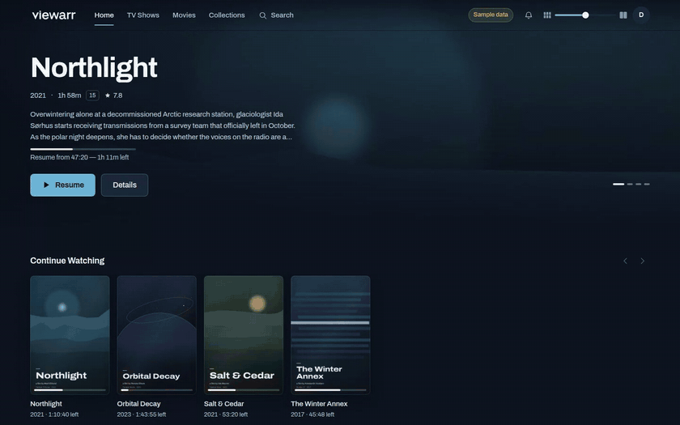

# Viewarr

Edit a film's details, choose its artwork and see which choices are protected from refreshes.

[Watch or download the full-resolution video](https://raw.githubusercontent.com/chaosen3/chaosen3/main/demos/viewarr/tour.mp4) · [Keeping manual edits through a rescan](keeping-manual-edits.md) · [Back to profile](../../README.md)

Captured from Viewarr's current interface with a fictional catalogue and procedural artwork. Edits and artwork choices use a capture-only in-memory adapter; the tour does not run a real scan, contact a metadata provider or play media. The engineering note explains the production behaviour and the separate storage tests used to check it.

No real library, account, media file or server connection was used. November 2026.
